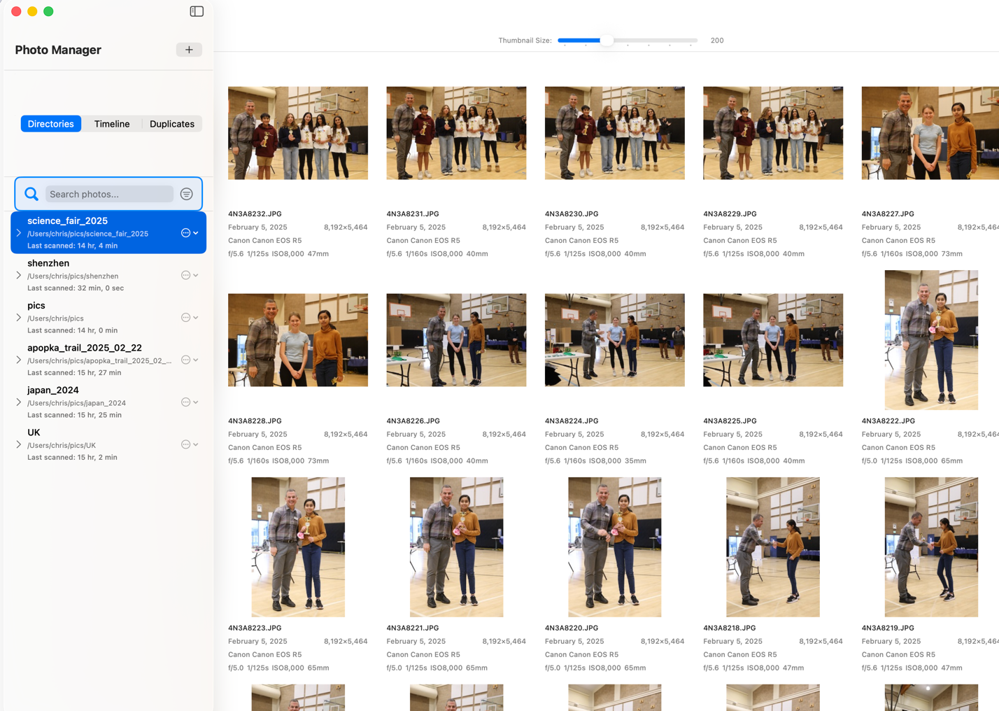
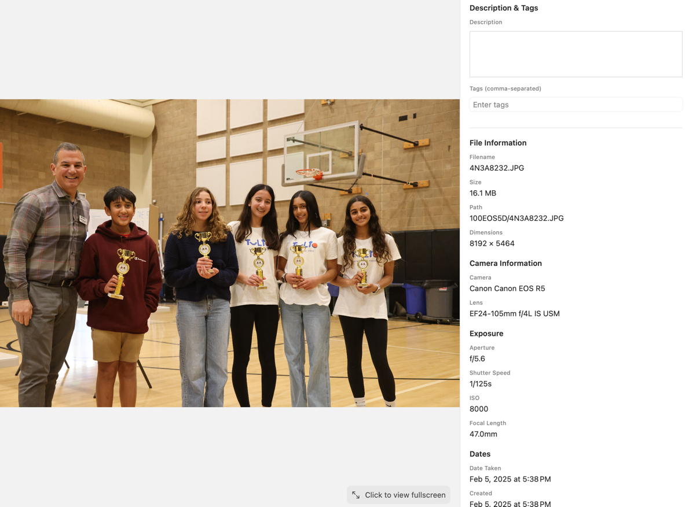
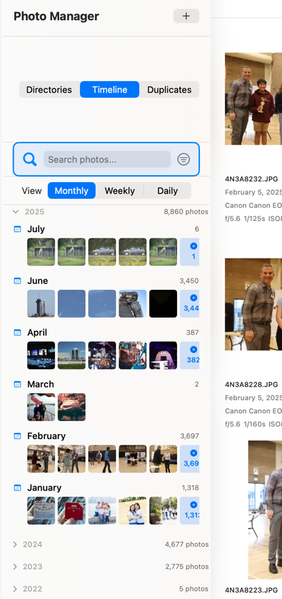
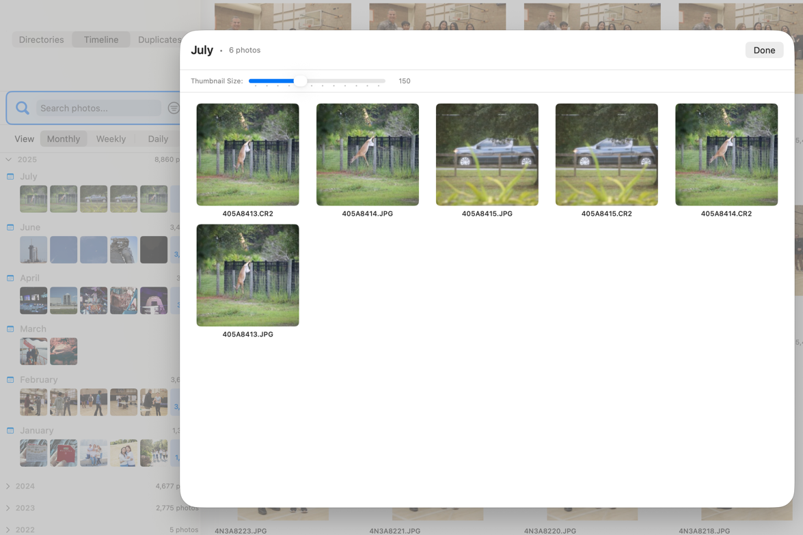
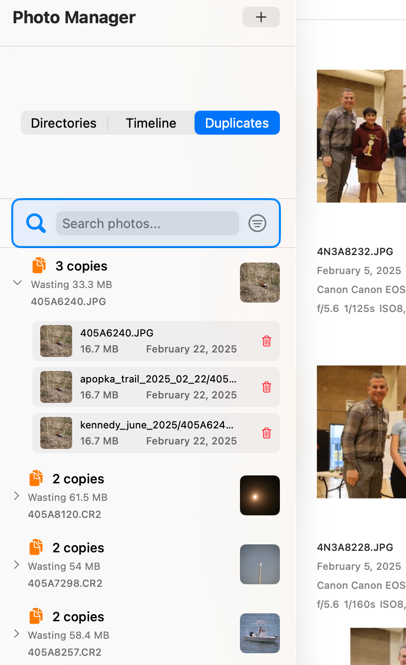
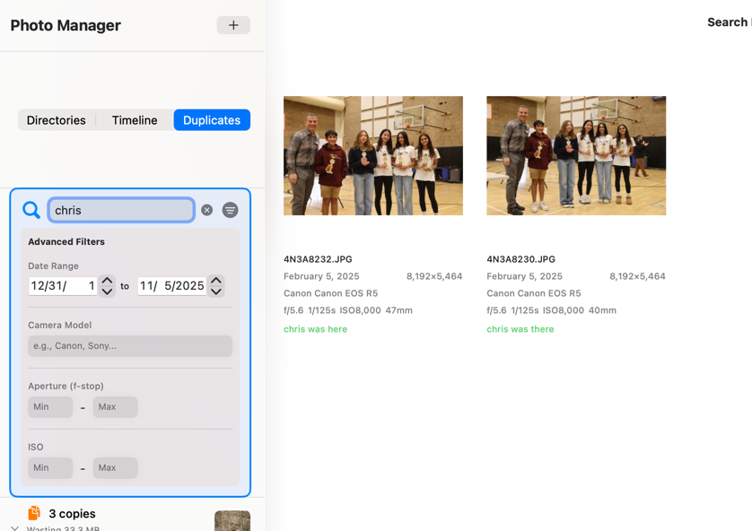

<p align="center">
  
</p>

# PhotoManager

A comprehensive photo management application for macOS built with Swift and SwiftUI. PhotoManager helps you organize, browse, and manage large photo collections with advanced features like duplicate detection, EXIF data extraction, and hierarchical browsing.

## Features

### Core Functionality
- **Directory Management**: Add and manage root directories containing your photo collections
- **Recursive Scanning**: Automatically scan directories and subdirectories for image files
- **EXIF Data Extraction**: Extract and display comprehensive metadata from photos
- **File Hashing**: Calculate SHA256 hashes for each file to enable duplicate detection
- **Thumbnail Generation**: Generate and cache thumbnails for fast browsing





### Browsing Modes
- **Directory View**: Browse photos organized by their actual directory structure
- **Timeline View**: Browse photos organized by year/month/day using EXIF date information
- **Duplicate View**: Find and manage duplicate photos across your collection

### Advanced Features
- **Duplicate Detection**: Hash-based duplicate detection with space savings calculations
- **Infinite Scroll**: Lazy loading for performance with large photo collections
- **Full Image Viewer**: Click thumbnails to view full-resolution images with EXIF data
- **Rescan Support**: Keep database in sync by rescanning directories
- **SQLite Database**: Robust local database storage







And search for keywords in description and tags along with date constraints and camera parameters:



## Organise Library (Library ▸ Organise Library…, ⇧⌘O)

A workbench for turning years of copied memory cards into one clean library, a group of photos at a time:

1. **Analyse**: pick the library folders. Byte-identical copies collapse to one, RAW+JPEG pairs and Live Photos
   stay together as one *shot*, and shots are grouped into **sessions** (split on time gaps and big location jumps)
   and **trips** (runs of busy days). Optional: look up place names for GPS photos (sends ~11 km cells to Apple's geocoder).
2. **Group & label**: an event tree (e.g. *Asia Trip ▸ Hong Kong ▸ Temples*) next to a timeline of groups. Name a
   group, assign it to the selected event, drag it onto an event, or open it to pick a subset, file it under a
   sub-event or tag the people in it. Assignments are saved immediately.
3. **Near-copies**: shots with several versions of one kind (exports, edits): keep all or keep the best.
4. **Plan**: choose a separate target folder and preview the tree:
   `YYYY/YYYY-MM-DD Event/Sub/Sub/` with RAW files in `RAW/` beside their JPEGs, unfiled photos in
   `YYYY/YYYY-MM Unsorted/`, photos without a trustworthy date in `Undated/<original folder>/`.
5. **Copy**: each file is copied under a temporary name, verified by SHA-256 and renamed into place; nothing in the
   target is ever overwritten and an interrupted run resumes. A manifest CSV and XMP sidecars (event path as
   hierarchical keywords, people, keywords, rating) are written to the target. Afterwards you can add the target
   to the library and move only originals that have a verified copy to the Trash.

## Library Insights (Library ▸ Library Insights, ⇧⌘I)

Views of the catalogue that don't depend on the folder layout: a pivot of any dimension (year/month/day/weekday/hour,
trip or event, person, keyword, country/city, camera, lens, focal length, aperture, ISO, file type, rating, date source,
folder) against an optional second one as bars or a heatmap, a calendar heatmap of shooting days, a map of GPS photos,
and saved views. Click any bar, cell, day or map bubble to see its photos.

## Safety

- Trashing goes through one guarded path that never removes the last remaining copy of a photo.
- Rescans update rows in place and never discard ratings, tags, descriptions or event assignments.
- Files that vanished are dropped from the catalogue only after a complete, error-free listing of a mounted root.
- Schema migrations write a backup copy of the database first (`PhotoManager.v<N>-backup-<timestamp>.sqlite`).

## Supported File Formats

- Images: JPEG, PNG, TIFF, HEIC/HEIF, GIF, BMP, WebP
- RAW: CR2, CR3, CRW, NEF, NRW, ARW, SR2, SRF, DNG, ORF, RW2, RAF, PEF, SRW, X3F, 3FR, IIQ, ERF, KDC, MRW, RWL
- Video: MOV, MP4, M4V, AVI, MTS, M2TS, 3GP (dates, GPS and Live Photo pairing from QuickTime metadata)

Capture dates come from EXIF, then QuickTime metadata, then a date in the file name (`IMG_20190312_101502.jpg`,
`Scan_19980704.tif`), and only then the file's modification date, which is flagged as unreliable.

## Requirements

- macOS 15.0 or later
- Xcode 16 or later
- [XcodeGen](https://github.com/yonaskolb/XcodeGen) (`brew install xcodegen`)

## Building the Application

The Xcode project is generated from `project.yml`, so every source file under `PhotoManager/` is included
automatically:

```sh
xcodegen generate
open PhotoManager.xcodeproj        # or: xcodebuild -scheme PhotoManager build
```

### Tests

```sh
xcodebuild -scheme PhotoManager test
```

Tests use throwaway databases; the app's own catalogue is never opened under XCTest.

To benchmark against a large, realistically messy library (trips, RAW+JPEG pairs, card dumps copied several times,
resized exports, scans), generate one inside the app's sandbox container and run the benchmark test:

```sh
LIB=~/Library/Containers/com.example.PhotoManager/Data/tmp/pm-bench
python3 tools/make_synthetic_library.py $LIB --shots 20000
TEST_RUNNER_PM_BENCH_LIBRARY=$LIB xcodebuild -scheme PhotoManager test -only-testing:PhotoManagerTests/BenchmarkTests
```

On an M-series Mac, 47,000 files (20,000 shots) scan in about 6 s, a rescan with no changes takes 0.5 s, and grid
pages, timelines and pivots return in milliseconds. The benchmark checks shots, duplicates, near-copies and trips
against the generator's ground truth.

## Usage

### Getting Started

1. **Launch PhotoManager**
   - The application will create its database and thumbnail directory automatically
   - Database: `~/Library/Application Support/PhotoManager/PhotoManager.sqlite`
   - Thumbnails: `~/Library/Application Support/PhotoManager/Thumbnails/`

2. **Add Photo Directories**
   - Click the "+" button in the sidebar
   - Select a directory containing your photos
   - The directory will be added to your root directories list

3. **Scan Directories**
   - Click the refresh icon next to any directory to scan it
   - PhotoManager will recursively scan for image files
   - EXIF data extraction and thumbnail generation happen automatically

### Browsing Your Photos

#### Directory Mode
- View photos organized by their actual directory structure
- Expand directories to see subdirectories and photo counts
- Click on any directory to view its photos in the main grid

#### Timeline Mode
- Photos are organized by year and month using EXIF date information
- Expand years to see months with photo counts
- Small thumbnail previews show a sample of photos in each month

#### Duplicates Mode
- View groups of duplicate photos found by hash comparison
- See wasted space calculations for each duplicate group
- Click to expand groups and see all duplicate locations
- Delete duplicates from the database (files remain on disk)

### Photo Viewing
- Click any thumbnail to open the full photo viewer
- View full-resolution images with zoom and scroll
- Detailed EXIF metadata panel shows:
  - File information (name, size, dimensions, path)
  - Camera information (model, lens)
  - Exposure data (aperture, shutter speed, ISO, focal length)
  - Date information (taken, created, modified)
  - Technical data (file hash, thumbnail status)

### Rescanning
- Use the refresh button next to directories to rescan
- Rescanning updates the database with new or changed files
- Removes database entries for deleted files
- Regenerates thumbnails as needed

## Project Structure

```
Sources/PhotoManager/
├── main.swift                          # Application entry point
├── Models/
│   └── DatabaseModels.swift           # Data models and database schema
├── Services/
│   ├── DatabaseManager.swift          # SQLite database operations
│   ├── FileScanningService.swift      # File scanning and EXIF extraction
│   ├── ThumbnailService.swift         # Thumbnail generation and management
│   └── PhotoLibrary.swift            # Main service coordinator
└── Views/
    ├── ContentView.swift              # Main application UI
    ├── DirectorySidebarView.swift     # Directory browsing sidebar
    ├── TimelineSidebarView.swift      # Date-based browsing sidebar
    ├── DuplicatesSidebarView.swift    # Duplicate detection interface
    ├── PhotoGridView.swift            # Main photo grid with infinite scroll
    ├── PhotoDetailView.swift          # Full photo viewer with EXIF display
    └── SettingsView.swift             # Application settings
```

## Database Schema

SQLite (WAL mode, foreign keys on), schema version 2, migrated automatically:

- `root_directories`: managed folders with security-scoped bookmarks
- `photo_files`: one row per file with path parts, content hash, best capture date and its source, EXIF, GPS,
  media kind, Live Photo content id, thumbnail, rating, colour, description and event; unique per root + path
- `events`: the nested event tree (trip ▸ place ▸ subject)
- `tags`, `photo_tags`: people and keywords
- `geo_cells`: cached place names for GPS areas
- `org_plans`, `org_plan_items`: organise plans, which double as the copy journal

## Architecture Notes

- **SwiftUI**: Modern declarative UI framework
- **Combine**: Reactive data binding with @Published properties
- **SQLite.swift**: Type-safe database operations
- **ImageIO**: Native macOS image processing for EXIF and thumbnails
- **CryptoKit**: Secure hash calculation for duplicate detection
- **Async/Await**: Modern Swift concurrency for file operations

## Performance Considerations

- Views page and aggregate in SQL (`PhotoFilter` → `WHERE`, `pivot`) instead of loading the whole library
- Scans are incremental (size + modification date), hash in parallel with streaming SHA-256 and write in batches
- Thumbnails are content-addressed (shared by copies), generated in parallel from embedded previews where possible,
  and loaded asynchronously through a memory-bounded cache
- Duplicate analysis runs off the main thread in a few queries

## Troubleshooting

### Common Issues

1. **Permission Errors**
   - Ensure PhotoManager has permission to access your photo directories
   - Grant Full Disk Access if needed in System Preferences → Security & Privacy

2. **Large Collections**
   - Initial scanning of large directories may take time
   - Thumbnail generation is progressive and happens in the background

3. **RAW File Support**
   - RAW file support depends on macOS system codecs
   - Some proprietary RAW formats may not be supported

### Logs and Debugging
- Check Console app for PhotoManager logs
- Database issues are logged to the console
- File scanning progress is displayed in the UI status area

## Future Enhancements

Potential improvements for future versions:
- Face clustering (on-device Vision) for people tags
- Move-in-place mode with an undo journal (currently copy-to-new-folder only)
- Photo editing integration
- Export and sharing features
- Cloud storage integration
- Custom thumbnail sizes

## License

This project is provided as-is for educational and personal use.